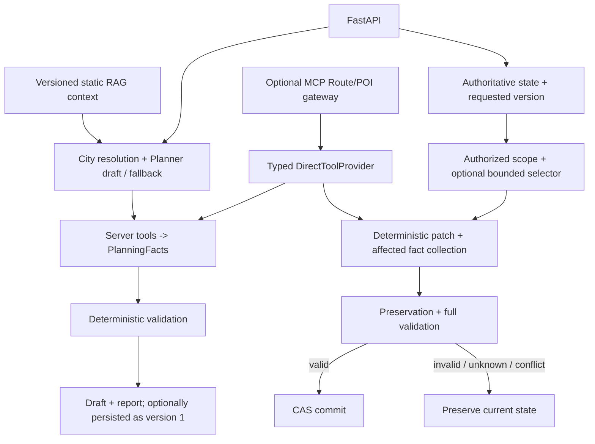

# 智旅云图 / Zhilv Yuntu

A constraint-aware travel planning system that combines LLM generation with server-grounded tools, deterministic validation, versioned partial replanning, and provenance-aware retrieval.

## Why this project exists

LLMs can generate plausible itineraries, but plausible does not mean feasible, grounded, or safely editable. This project separates generation from checks on constraints, place identity, route evidence and state mutation. Missing evidence stays unknown; an attractive description cannot authorize an edit.

## Core capabilities

1. **Constraint-aware planning** — persisted `TripConstraints` and deterministic checks for supported hard requirements.
2. **Tool-grounded feasibility** — server-side POI identity and driving observations, with freshness and endpoint binding.
3. **Explicit uncertainty** — `valid`, `invalid` and `unverifiable`, with structured findings and route coverage.
4. **Versioned partial replanning** — stable activity IDs, authorized single-day/single-operation changes, preservation checks and valid-only CAS commits.
5. **Bounded LLM selection** — one-shot selection from a server-authorized candidate set; invented IDs and stale grants cannot become arbitrary patches.
6. **Provenance-aware RAG** — typed retrieval, current corpus membership, chunk hashes, versioned index/cache identities and explicit degradation.

## Architecture



Initial drafts can be stored with `invalid` or `unverifiable` reports. **Valid-only commit applies to replanning**, not initial draft creation. See [architecture and source evidence](docs/final-architecture.md).

LLM generates / selects. Tools provide observations. Deterministic code validates. Authoritative state is server-owned. Unknown evidence remains unknown. Only valid replans commit.

## Reliability examples

- Two activities have a 20-minute gap, but the driving observation is 35 minutes: `route_time_violation`.
- A required route provider times out: `unverifiable`; the failed replan leaves the active record unchanged.
- Replacing one attraction changes only the authorized scope and permitted derived fields, recollects affected facts, then runs full validation and CAS.

## Run the offline benchmark

From the repository root, with an activated Python environment:

```sh
python -m pip install -r backend/requirements.txt
python -B backend/scripts/evaluate_end_to_end.py
python -B backend/scripts/evaluate_frozen_suites.py --output frozen-results.json
python -B backend/scripts/run_offline_regression.py --suite full --output regression-results.json
```

The E2E runner uses fixed corpus data, replay tools/model outputs, a deterministic evaluation clock and temporary SQLite. It needs no API keys, Redis server, live embeddings/reranker or Chroma deployment. The frozen MCP suite uses a local loopback HTTP server with replay providers. No external provider is required. Write optional result files outside the repository if you do not want local artifacts.

Verification used an existing Python 3.13.5 environment; a fresh dependency installation and Docker build were **not** validated in Phase 4. In particular, the verification environment has pytest 9.1.1, while the declared requirement is `pytest>=8,<9`. See the [environment record](docs/final-benchmark.md) before treating these commands as a verified clean-install recipe.

## Evaluation scope

The evaluation suites are fixed offline regression and contract benchmarks. They test deterministic invariants, grounding boundaries, state preservation, retrieval behavior and failure handling. **They are not production accuracy estimates.** Parameterized test instances are not independent travel scenarios.

| Capability | Dataset | What the result supports |
|---|---:|---|
| Constraint validation | 67 cases | Deterministic rule regression |
| Route evidence | 48 cases | Known/unknown route semantics |
| MCP contract | 28 cases | Direct/protocol equivalence with replay providers |
| Deterministic replanning | 50 cases | Authorized mutation and failure handling |
| Selector contract | 36 cases | Bounded output authority and failure mapping |
| RAG v2 | 60 cases | Retrieval quality, provenance and failure behavior |
| Cross-layer E2E | 24 scenarios | HTTP generation/replanning plus route/RAG service boundaries |

E2E: **24/24 expected scenario outcomes**, failure-state preservation **11/11** (including **6/6 failed replans**), measured unauthorized mutations **0**. Initial non-valid drafts are excluded from the failed-replan denominator because initial persistence is intentional. Concurrent conflict checks preserve the winning writer's state, not the earlier revision. Full backend: **1308 passed, 0 failed, 0 skipped, 0 collection errors** in the recorded environment.

Keyword baseline on RAG v2: Recall@1 **62.96%**, Recall@3 **72.22%**, Recall@5 **74.07%**, MRR **0.7167**. These use 54 positive-label cases; the remaining six are no-data controls. Semantic-preference Recall@6 remains **0% over 12 cases**. It is retained as evidence of a retrieval weakness, not relabeled into success. The E2E semantic scenario checks that this known weakness is reported honestly.

[Benchmark report](docs/final-benchmark.md) · [Per-scenario machine-readable results](docs/phase4-e2e-results.json) · [Test inventory](docs/test-inventory.md)

### Verified offline

Deterministic validation; state preservation and CAS conflict behavior; candidate authorization; typed tool/protocol contracts; provenance and cache/version checks. Fake/replay prompt-injection text tests authority enforcement, **not a real model's injection resistance**.

### Not yet verified live

Real provider reliability, real LLM selection quality, production latency, future traffic accuracy, real ticket/hotel inventory, opening hours and real-world itinerary quality. No offline fixture timing is presented as production latency.

## Technology actually used

Backend: FastAPI, Pydantic, SQLAlchemy/SQLite, LangChain with an OpenAI-compatible client. Retrieval: Chroma and optional DashScope reranking, with keyword/rule fallback. Tools: Amap APIs and the optional MCP Python SDK gateway. Redis is an optional cache. Frontend: Vue 3, TypeScript, Vite and Ant Design Vue. Docker/Compose files exist; Phase 4 does not verify a deployed build.

Dependencies: [backend requirements](backend/requirements.txt), [frontend package](frontend/package.json). This is not a LangGraph, multi-agent, MySQL, BM25/RRF or BGE-M3 implementation.

## Local application and demo

Configure local credentials from [backend example](backend/.env.example) and the frontend endpoint from [frontend example](frontend/.env.example). Then, in separate terminals:

```sh
# From backend/
uvicorn app.api.main:app --reload --port 8000
```

```sh
# From frontend/
npm ci
npm run dev
```

The backend exposes interactive API docs at `/docs`. Optional vector ingestion is `python scripts/ingest_data.py` from `backend/`; it writes a versioned index and calls the configured embedding provider. It is not part of the offline benchmark. The existing [Compose configuration](docker-compose.yaml) runs frontend/backend/Redis and requires a local backend environment file.

Shortest reliability demo: **Generate → inspect validation → prepare candidates → replan → inspect accepted/rejected/unverifiable/conflict and state version**. Use the API or [offline demo checklist](docs/demo-checklist.md) for managed replanning. The current UI generates managed drafts but does not yet expose the candidate/replan workflow; its legacy edit API cannot overwrite managed state.

## Known limitations

- Driving-only route feasibility for discoverable timed pairs; initial local plans typically have one timed attraction per day and limited route coverage.
- No live opening-hours, booking or price-inventory validation. Cost totals and transport prices remain estimates. A route duration is not a future traffic guarantee.
- Single-day, single-operation attraction replanning; no full-trip optimization or autonomous repair loop.
- Candidate grants use a single-process cache; no distributed cache consistency or multi-database guarantees.
- Static RAG covers six current cities. Keyword retrieval has the measured semantic-preference weakness; real vector/model quality has not been benchmarked here.
- No production authentication/security guarantee. Existing Planner debug/error logging includes model endpoint and response previews; deployment privacy review remains necessary.
- Frontend replanning UX, browser build, fresh install and Docker deployment are outside this verification run.

## Why these boundaries?

**Why not more agents or LangGraph?** The workflow is mostly deterministic orchestration with one-shot generation/selection boundaries. Additional agents or a graph runtime would add state coordination without addressing a demonstrated current bottleneck.

**Why MCP?** It is an optional standardized Route/POI gateway for evaluation and external consumers. Production orchestration still uses `DirectToolProvider`; MCP does not power an autonomous agent.

**Why no BM25/RRF yet?** The benchmark exposed semantic-retrieval weakness, but there is not yet enough live/vector ablation evidence to justify adding hybrid retrieval or replacing the embedding model.

## Engineering evidence

[Architecture](docs/final-architecture.md) · [Claim safety](docs/claim-safety.md) · [Resume evidence](docs/resume-evidence.md) · [Interview notes](docs/interview-notes.md)

Earlier Phase 1–3.5 documents and [CHANGELOG](CHANGELOG.md) are historical records, including old test counts and retrieval measurements. They are not the current evidence baseline. Use the final benchmark report for current claims.
