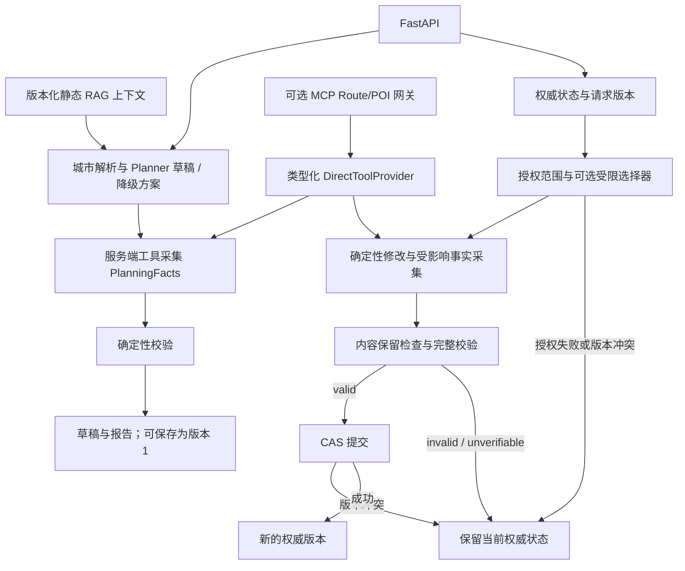

# 智旅云图 / Zhilv Yuntu

一个约束感知的旅行规划系统，将 LLM 行程生成、服务端工具证据、确定性校验、版本化局部重规划和可追溯 RAG 结合起来。

## 当前进度

Phase 1–3.5 的核心能力已完成；Phase 4 的端到端离线评估与工程文档已在 `c28879a` 提交，并发布到本仓库。当前已验证的是固定离线场景下的规则、协议和状态边界；真实外部服务、模型质量及部署仍待独立验证。

## 项目解决什么问题

大模型可以生成看起来合理的行程，但这不等于地点身份可靠、时间安排可行，也不等于修改行程时能保留用户未要求修改的内容。本项目将生成与约束、地点身份、路线证据和状态变更检查分开处理。缺失的证据保持为未知，模型的描述不能直接获得修改权限。

## 核心能力

1. **约束感知规划**：持久化 `TripConstraints`，对已支持的硬约束执行确定性检查。
2. **工具证据驱动的可行性校验**：服务端采集 POI 身份与驾驶路线观察，检查新鲜度及路线端点绑定。
3. **显式表达不确定性**：输出 `valid`、`invalid` 或 `unverifiable`，附带结构化发现和路线覆盖信息。
4. **版本化局部重规划**：通过稳定活动 ID、单日单项授权范围、内容保留检查和版本 CAS，仅提交校验通过的重规划结果。
5. **受限 LLM 候选选择**：模型只能一次性选择服务端授权候选集中的 ID；虚构 ID 和过期授权不能转化为任意修改。
6. **可追溯 RAG**：提供类型化检索结果，校验当前语料成员身份与 chunk 哈希，绑定索引/缓存版本，并明确记录降级行为。

## 系统架构



初始草稿可以携带 `invalid` 或 `unverifiable` 报告保存。**“仅提交 valid 结果”适用于重规划，不适用于初始草稿创建。** 详细链路和源码映射见[架构文档](docs/final-architecture.md)。

设计原则：LLM 负责生成或选择；工具提供观察；确定性代码执行校验；服务端拥有权威状态；未知证据保持未知；仅校验通过的重规划结果可以提交。

## 可靠性示例

- 两个活动之间只有 20 分钟，驾驶路线估计需要 35 分钟：报告 `route_time_violation`。
- 必需的路线服务超时：结果为 `unverifiable`，失败重规划不改变当前权威记录。
- 替换一个景点：仅修改授权范围及允许的派生字段，重新采集受影响事实，再执行完整校验和 CAS。

## 运行离线评估

在仓库根目录、已激活的 Python 环境中执行：

```sh
python -m pip install -r backend/requirements.txt
python -B backend/scripts/evaluate_end_to_end.py
python -B backend/scripts/evaluate_frozen_suites.py --output frozen-results.json
python -B backend/scripts/run_offline_regression.py --suite full --output regression-results.json
```

E2E 使用固定语料、工具/模型回放、确定性评估时钟和临时 SQLite，不需要 API key、Redis 服务、在线 embedding/reranker 或 Chroma 部署。冻结的 MCP 评估使用本机回环 HTTP 服务和回放 provider，无需真实外部服务。不希望留下本地产物时，可将输出路径设在仓库外。

Phase 4 使用已有 Python 3.13.5 环境验证，**尚未验证全新依赖安装或 Docker 构建**。其中 pytest 为 9.1.1，而声明的依赖范围为 `pytest>=8,<9`。因此，上述命令不能视为已经验证的全新安装流程，详见[环境记录](docs/final-benchmark.md)。

## 评估范围与结果

这些评估是固定的离线回归与契约基准，检查确定性不变量、证据绑定边界、状态保护、检索行为和失败处理。**它们不代表生产准确率。** 参数化展开的测试实例也不等于独立旅行场景。

| 能力 | 数据集规模 | 验证范围 |
|---|---:|---|
| 约束校验 | 67 个样例 | 确定性规则回归 |
| 路线证据 | 48 个样例 | 已知/未知路线语义 |
| MCP 契约 | 28 个样例 | 回放 provider 下直接调用与协议调用的一致性 |
| 确定性重规划 | 50 个样例 | 授权修改与失败处理 |
| 选择器契约 | 36 个样例 | 模型输出权限边界与失败映射 |
| RAG v2 | 60 个样例 | 检索质量、来源和失败行为 |
| 跨层 E2E | 24 个场景 | HTTP 生成/重规划及路线、RAG 服务边界 |

E2E **24/24 场景符合预期**；失败状态保护 **11/11**，其中失败重规划 **6/6**；实际检测到的未授权变更为 **0**。初始非 valid 草稿的创建是正常行为，不计入失败重规划分母。并发冲突检查保护已获胜写入方的当前状态，而非恢复旧版本。记录环境中的完整 backend 结果为 **1308 passed、0 failed、0 skipped、0 collection errors**。

RAG v2 关键词基线：Recall@1 **62.96%**、Recall@3 **72.22%**、Recall@5 **74.07%**、MRR **0.7167**。这些指标使用 54 个正例，其余 6 个为无数据对照。**12 个语义偏好样例的 Recall@6 仍为 0%**，这一弱点被保留，没有通过修改标签包装为成功。E2E 语义场景检查的是系统如实呈现已知检索弱点。

[评估报告](docs/final-benchmark.md) · [逐场景结果](docs/phase4-e2e-results.json) · [测试清单](docs/test-inventory.md)

### 已完成离线验证

确定性校验、状态保护与 CAS 冲突处理、候选授权、类型化工具/协议契约、来源校验以及缓存/版本行为。包含恶意指令文本的回放测试验证的是权限边界，**不代表真实模型的提示注入防御能力**。

### 尚未完成在线验证

真实外部服务可靠性、真实 LLM 候选选择质量、生产延迟、未来路况准确性、实时门票/酒店库存、营业时间和真实旅行体验。离线 fixture 执行耗时不作为生产延迟指标。

## 实际使用的技术

- **后端**：FastAPI、Pydantic、SQLAlchemy/SQLite、LangChain 与 OpenAI-compatible 客户端。
- **检索**：Chroma、可选 DashScope 重排序，以及关键词/规则降级路径。
- **工具**：高德地图 API、可选 MCP Python SDK 网关；Redis 用于可选缓存。
- **前端**：Vue 3、TypeScript、Vite、Ant Design Vue。
- **部署配置**：已有 Docker/Compose 文件，Phase 4 尚未验证部署构建。

依赖见[后端 requirements](backend/requirements.txt)和[前端 package](frontend/package.json)。当前没有实现 LangGraph、多 Agent、MySQL、BM25/RRF 或 BGE-M3。

## 本地启动与演示

参考[后端环境示例](backend/.env.example)配置本地凭据，参考[前端环境示例](frontend/.env.example)配置后端地址。分别在两个终端执行：

```sh
# 在 backend/ 目录中
uvicorn app.api.main:app --reload --port 8000
```

```sh
# 在 frontend/ 目录中
npm ci
npm run dev
```

后端交互式 API 文档位于 `/docs`。如需构建向量索引，可在 `backend/` 中执行 `python scripts/ingest_data.py`；该命令会调用配置的 embedding 服务并写入版本化索引，**不属于离线评估步骤**。现有 [Compose 配置](docker-compose.yaml)运行前端、后端和 Redis，需要本地后端环境文件。

最短可靠性演示流程：**生成 → 查看校验报告 → 准备替换候选 → 重规划 → 查看 accepted/rejected/unverifiable/conflict 与状态版本**。受管重规划请使用 API 或[离线演示清单](docs/demo-checklist.md)。当前 UI 会生成受管草稿，但尚未接入候选/重规划流程；旧编辑 API 不能覆盖受管状态。

## 已知限制

- 仅对可发现的带时间活动对检查驾驶路线可行性；本地初始行程通常每天只有一个带时间的景点，路线覆盖有限。
- 不校验实时营业时间、预订或价格库存。总费用与交通费用仍是估算，路线耗时不保证未来交通状况。
- 重规划限制为单日、单项景点操作，不提供全程优化或自主修复循环。
- 候选授权使用单进程缓存，没有分布式缓存一致性或多数据库保证。
- 静态 RAG 覆盖当前六个城市。关键词基线存在上述语义偏好弱点，本轮未评估真实向量检索或模型质量。
- 不提供生产认证/安全保证。现有 Planner 调试和错误日志包含模型 endpoint 与响应预览，部署前仍需隐私审查。
- 前端重规划交互、浏览器构建、全新安装和 Docker 部署均不在本轮验证范围内。

## 技术取舍

**为什么没有更多 Agent 或 LangGraph？** 当前主要是确定性编排与一次性生成/选择边界。额外 Agent 或图执行框架会增加状态协调复杂度，尚无证据表明它们能解决当前瓶颈。

**为什么保留 MCP？** MCP 为评估和外部消费者提供可选的标准化 Route/POI 网关。生产编排仍使用 `DirectToolProvider`，MCP 不承担自主 Agent 的执行循环。

**为什么暂未加入 BM25/RRF？** 评估暴露了语义检索弱点，但尚缺在线向量检索及消融对比证据，不能据此认定应引入混合检索或替换 embedding 模型。

## 工程证据

[架构说明](docs/final-architecture.md) · [可声明范围](docs/claim-safety.md) · [简历证据映射](docs/resume-evidence.md) · [面试材料](docs/interview-notes.md)

Phase 1–3.5 文档及 [CHANGELOG](CHANGELOG.md)保留历史测试数量与检索测量，当前能力声明应以最终评估报告为准。部分附属文档描述的是 Phase 4 提交前的审查状态；评估 JSON 中的基线 commit 和 dirty 标记属于当时的运行证据，不随后续提交改写。
