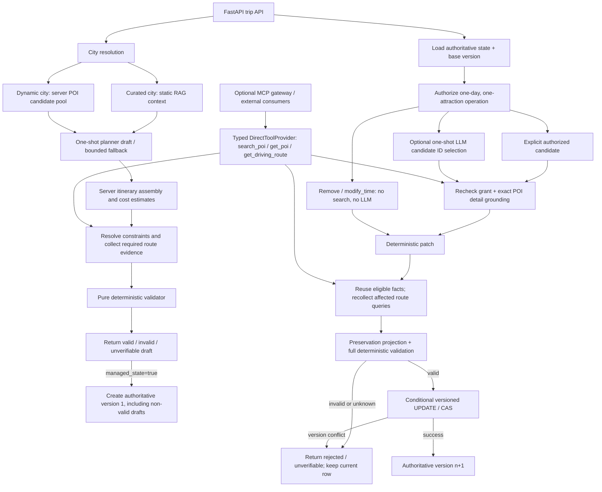

# Final architecture and trust boundaries

Baseline: `dcee713c065bd75251f81fbb1784e6d5b4d1f5f8` (Phase 3.5). Phase 4 adds evaluation and documentation; production semantics remain frozen.

## Planning and state

The initial-create and replan-commit boundaries deliberately differ. `create_authoritative_draft` establishes identity and server ownership; it is not a valid-only publication gate. `compare_and_swap_plan` revalidates a replan and conditionally updates the expected revision. An existing managed draft can therefore carry `invalid` or `unverifiable`; callers must inspect its report.

`baseline_trusted` means the generation/persistence boundary owns the baseline, not that every constraint is satisfied or every place is live-verified. Legacy saved itineraries migrate with `baseline_trusted=false` and are not eligible for trusted replanning. Managed state cannot be overwritten through legacy `/trip/edit` or a client-supplied `/trip/save` body. Save archives the managed record.

## RAG

```mermaid
flowchart LR
    Query[KnowledgeQuery / canonical destination] --> Snapshot[Current logical corpus snapshot + version identity]
    Snapshot --> Cache[Version and request-bound cache]
    Cache --> Retrieve[Vector retrieval or explicit keyword baseline/fallback]
    Rewrite[Optional bounded query rewrite] --> Query
    Retrieve --> Rank[Optional DashScope reranker / rule fallback]
    Rank --> Provenance[Current snapshot membership, ID, source and content validation]
    Cache -->|cache hit also validated| Provenance
    Provenance --> Result[KnowledgeResult: success / no_data / error + stage events]
    Result --> Context[Bounded static untrusted Planner context]
```

The planner adapter performs optional rewrite before calling retrieval; direct `retrieve_knowledge` accepts a supplied rewrite result. It does not autonomously rewrite every query. Index building creates a fresh versioned Chroma collection, reads it back, and atomically publishes a pointer. Query-side cache identities bind index/config/schema/request; cached chunks are revalidated against the current source snapshot. The default vector path can explicitly degrade to a keyword/rule fallback. The Phase 4 RAG scenarios deliberately use `keyword_baseline`.

No RAG chunk becomes a `PlanningFacts` observation. A guide mentioning opening hours or prices remains static reference text. Vector distances and rerank scores are retrieval signals, not operational confidence or calibrated probabilities.

## Source map

| Boundary | Source |
|---|---|
| HTTP generation/state/candidates/replan | [trip.py](../backend/app/api/routes/trip.py) |
| Initial orchestration, estimated budget and fallback | [trip_service.py](../backend/app/services/trip_service.py) |
| Planner and selector model boundaries | [trip_planner_agent.py](../backend/app/agents/trip_planner_agent.py), [candidate_selector.py](../backend/app/agents/candidate_selector.py) |
| Pure constraints and route checks | [plan_validator.py](../backend/app/services/plan_validator.py), [route_validation.py](../backend/app/services/route_validation.py) |
| Initial evidence collection | [planning_fact_service.py](../backend/app/services/planning_fact_service.py) |
| Typed tools / optional protocol | [tool_contracts.py](../backend/app/models/tool_contracts.py), [tool_adapter.py](../backend/app/services/tool_adapter.py), [MCP server](../backend/app/mcp/server.py) |
| Strict authoritative loading and CAS | [authoritative_state.py](../backend/app/services/authoritative_state.py) |
| Replan scope, merge, evidence and selector wrapper | [replanning_service.py](../backend/app/services/replanning_service.py), [plan_patch_service.py](../backend/app/services/plan_patch_service.py), [replanning_facts.py](../backend/app/services/replanning_facts.py), [replanning_selection.py](../backend/app/services/replanning_selection.py) |
| Typed retrieval, index and corpus identity | [knowledge_service.py](../backend/app/rag/knowledge_service.py), [index_store.py](../backend/app/rag/index_store.py), [snapshot.py](../backend/app/rag/snapshot.py), [versions.py](../backend/app/rag/versions.py) |

## Ownership and uncertainty

- The client provides intent, an operation, identifiers and an expected version. It cannot supply authoritative evidence, arbitrary patches or a new constraint baseline through replan.
- The LLM drafts or selects from server-authorized candidate IDs. Rationale is explanatory data; it cannot change the edit scope or bypass validation. Grant and version checks happen again after selection.
- Tools return typed observations with units, source, freshness and failure metadata. Tool success alone does not mean itinerary feasibility.
- The collector binds observations to plan identities and query endpoints. The pure validator consumes a snapshot at an explicit evaluation time, without API/network/database calls.
- Route evidence covers driving estimates for discoverable timed pairs. Missing identity, coordinates, evidence, unsupported mode or stale observations leave uncertainty explicit. An empty set of required pairs does not certify a whole journey.
- A replan mutates one attraction on one day, plus independently checked derived transport/budget fields. Unaffected content and hard constraints are preserved. CAS protects competing writes; it does not establish distributed cache coherence.
- Candidate grants live in a single-process store. SQLite is the current authoritative persistence target. There is no production authentication boundary.

## Technology decisions

| Decision | Reason and trade-off |
|---|---|
| Pure validator | Repeatable snapshot decisions; freshness and provider failures must be handled before validation. |
| Direct tools plus optional MCP | Production avoids an extra protocol hop; MCP gives external consumers the same typed Route/POI contract. |
| One-shot selection | Bounded authority, deadlines and simpler failure handling; no autonomous repair loop. |
| Deterministic patches rather than whole-plan regeneration | Preserve unrelated user choices; scope intentionally limited to one operation/day. |
| Valid-only CAS for replans | Invalid/unknown candidate changes never become the new active revision. Initial drafts remain explicitly distinguishable. |
| No LangGraph or multi-agent runtime | Current bounded generation/selection and deterministic orchestration do not demonstrate a need for extra coordination. |
| Static RAG separate from dynamic facts | Source traceability cannot substitute for operational freshness. |
| No BM25/RRF/BGE-M3 addition | Keyword semantic weakness is measured, but live vector/ablation evidence does not yet justify a retrieval replacement. |

Weather is a display/tool capability, not a hard feasibility validator. Export, history and legacy editing remain separate application features. Frontend generation requests managed state, but the current frontend API client has no candidate/replan methods; use API documentation or offline scenarios to demonstrate the Phase 3 workflow.
